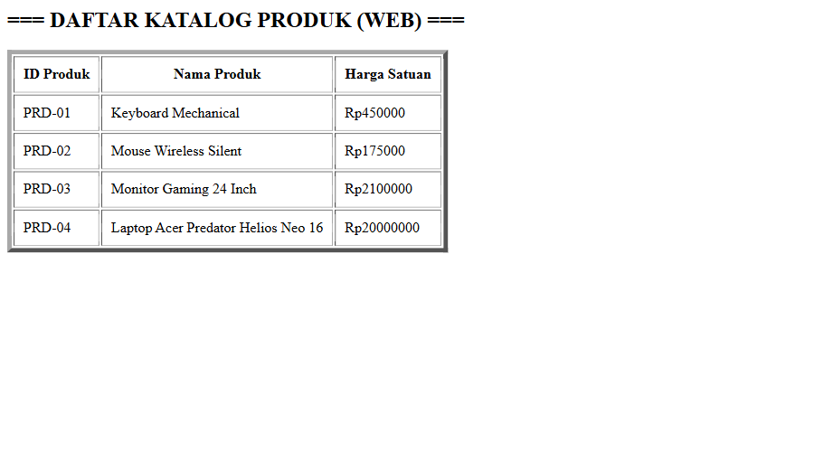
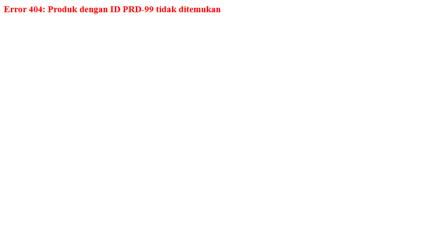

# Catalog Product

Aplikasi web katalog produk sederhana berbasis **Jakarta Servlet** yang dijalankan dengan **Embedded Tomcat** (tanpa perlu instal Tomcat terpisah). Data produk dan kategori disimpan di memori (in-memory).

## Teknologi

| Komponen | Versi |
|---|---|
| Java | 17 |
| Maven | 3.x |
| Jakarta Servlet API | 6.0.0 |
| Tomcat Embed Core | 10.1.18 |
| JUnit | 4.11 |

## Struktur Proyek

```
catalog-product/
├── pom.xml
├── cp.txt                         # classpath dependency (untuk menjalankan via java -cp)
└── src/
    ├── main/java/com/budiluhur/catalog/
    │   ├── App.java               # entry point, menjalankan Embedded Tomcat di port 8080
    │   ├── exception/
    │   │   └── ProductNotFoundException.java
    │   ├── model/
    │   │   ├── Category.java      # id (int), name
    │   │   └── Product.java       # id (String), name, price
    │   ├── repository/
    │   │   └── ProductRepository.java  # addProduct, findAll, findById
    │   └── servlet/
    │       ├── CategoryServlet.java    # GET /categories
    │       └── ProductServlet.java     # GET /products
    └── test/java/com/budiluhur/
        └── AppTest.java
```

## Cara Menjalankan

1. Compile proyek:

   ```bash
   mvn compile
   ```

2. (Opsional) Buat ulang `cp.txt` jika dependency berubah atau path `.m2` berbeda:

   ```bash
   mvn dependency:build-classpath "-Dmdep.outputFile=cp.txt"
   ```

3. Jalankan server:

   **PowerShell**
   ```powershell
   java -cp "target/classes;$(Get-Content cp.txt)" com.budiluhur.catalog.App
   ```

   **Git Bash / Linux / macOS** (di Linux/macOS ganti `;` dengan `:`)
   ```bash
   java -cp "target/classes;$(cat cp.txt)" com.budiluhur.catalog.App
   ```

4. Buka di browser:
   - http://localhost:8080/products
   - http://localhost:8080/categories

Hentikan server dengan `Ctrl + C`.

## Endpoint

| Method | URL | Keterangan |
|---|---|---|
| GET | `/products` | Menampilkan tabel semua produk |
| GET | `/products?id={id}` | Menampilkan detail produk berdasarkan ID; `404` jika tidak ditemukan |
| GET | `/categories` | Menampilkan daftar kategori |

Contoh: http://localhost:8080/products?id=PRD-01

## Screenshot

**Daftar produk** — `GET /products`



**Detail produk** — `GET /products?id=PRD-01`


**Produk tidak ditemukan** — `GET /products?id=PRD-99` (HTTP 404)



**Daftar kategori** — `GET /categories`


## Data Awal

**Produk**

| ID | Nama | Harga (Rp) |
|---|---|---|
| PRD-01 | Keyboard Mechanical | 450000 |
| PRD-02 | Mouse Wireless Silent | 175000 |
| PRD-03 | Monitor Gaming 24 Inch | 2100000 |
| PRD-04 | Laptop Acer Predator Helios Neo 16 | 20000000 |

**Kategori**

| ID | Nama |
|---|---|
| 1 | Elektronik |
| 2 | Aksesoris Komputer |
| 3 | Peralatan Gaming |

## Catatan

- Data disimpan di memori dan di-reset setiap server di-restart.
- Parameter `id` pada pesan error di-escape untuk mencegah XSS.
- Menjalankan test: `mvn test`.
